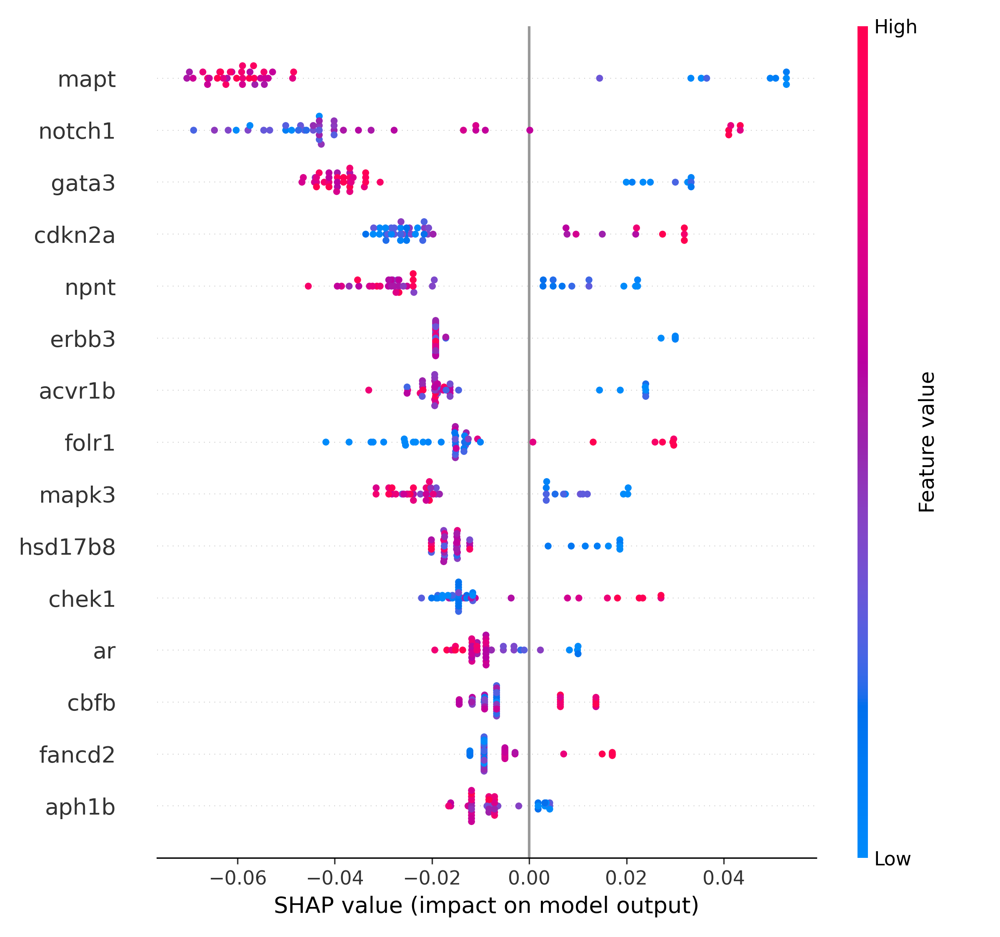
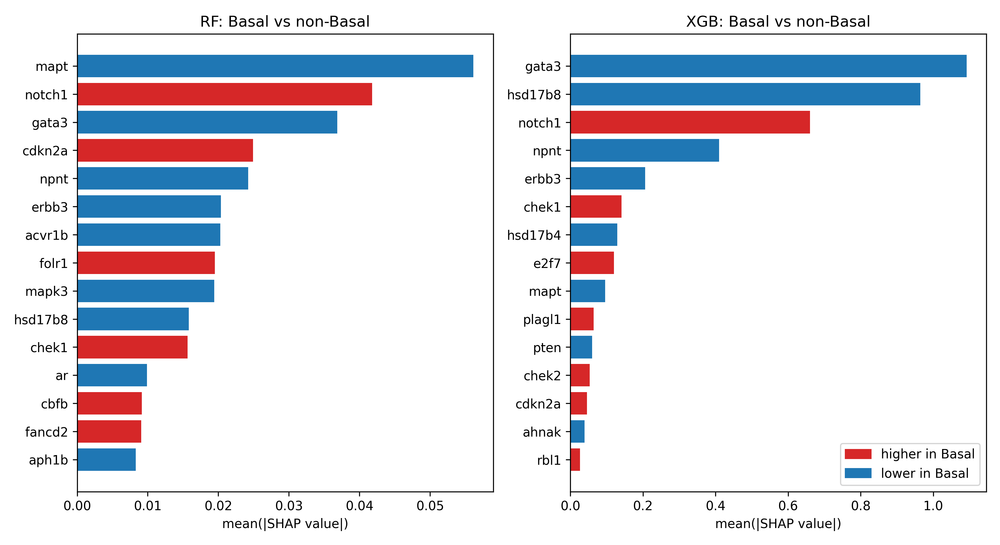

## Overview

Gene expression data usually has more features than samples, so
choosing which genes are selected for a classifier matters as much as choosing
the classifier. This project documents one way to do that selection:
(1) WGCNA finds groups of co-expressed genes without looking at the class
label; (2) Differential expression finds genes that separate the two classes,
and (3)the **intersection** keeps genes that are both. The resulting short
gene list is then used to train and evaluate machine learning models.

The dataset is **METABRIC** breast cancer expression and clinical data
(Pereira et al., 2016), accessed through a Kaggle re-upload on this link https://www.kaggle.com/datasets/raghadalharbi/breast-cancer-gene-expression-profiles-metabric,  
1,699 samples, 489 genes (z-scored expression), clinical traits and a
PAM50 subtype label. The classification task is **Basal vs non-Basal**.

## Workflow

| # | Step | Language | Output |
|---|------|----------|--------|
| 1 | WGCNA | R | 132 module genes (blue, turquoise, brown, yellow) |
| 2 | DGE | Python | 165 significant genes |
| 3 | Overlap | Python | 79 genes with module labels |
| 4 | ML + SHAP | Python | Performance, p-values, SHAP genes |

## Methods

**1. WGCNA (R).** Ran WGCNA once, globally, on the full expression
matrix. Modules were kept when their eigengene correlated with clinical
traits (significant modules: blue, turquoise, brown, yellow).
Running WGCNA only once, before any differential testing, keeps the
two selection views independent of each other, which is the point of
intersecting them later.

**2. Differential expression (Python).** METABRIC expression is
z-scored array data, not raw counts, so DESeq2-style count models do not
apply. Each gene was tested with Mann-Whitney U and a t-test, p-values
were corrected with Benjamini-Hochberg, and a gene was called significant
at padj < 0.05 and |mean difference in z-score| > 0.5.

**3. Overlap.** Genes significant in step 2 were intersected with the module
genes from step 1. It was necessary to standardize the gene names to 
prevent bugs caused by inconsistent naming formats.

**4. Machine learning on a small sample.** To test how the approach
behaves when samples are scarce, 42 samples were drawn (6 Basal, 36
non-Basal) and three models were evaluated with **nested leave-one-out
cross-validation** on the 79 overlap genes.

```python
# Fixed hyperparameters: tuning inside every LOO fold was too slow on Colab
rf  = RandomForestClassifier(n_estimators=100, class_weight="balanced")
xgb = XGBClassifier(max_depth=3, learning_rate=0.1, scale_pos_weight=6)
svm = make_pipeline(StandardScaler(), SVC(kernel="rbf", C=1))
```

Balanced accuracy was used because the classes are imbalanced (accuracy
alone would reward predicting "non-Basal" every time). Significance was
assessed with a **50-fold label permutation test**, and robustness with
10 different random subsamples. SHAP values were computed for the models
that were stable.

## Results

| Model | Balanced accuracy | Permutation p | Sensitivity | Specificity |
|-------|------------------|---------------|-------------|-------------|
| Random Forest | 0.750 | 0.0196 | 0.50 | 1.00 |
| XGBoost | 0.722 | 0.0588 | 0.50 | 0.94 |
| SVM | 0.667 | 0.0196 | 0.33 | 1.00 |

Across 10 random subsamples, mean balanced accuracy was
0.696 ± 0.073 (RF), 0.697 ± 0.095 (XGBoost) and 0.678 ± 0.155 (SVM). The
SVM fell to chance level in three of the ten subsamples, so it was left
out of the SHAP step.




For RF and XGBoost, the genes ranked in the top 15 by SHAP in both
models were *GATA3, NOTCH1, NPNT, MAPT, ERBB3, HSD17B8, CDKN2A* and
*CHEK1*. Comparing mean z-scores between the groups in the 42 samples,
*HSD17B8, GATA3, MAPT, ERBB3* and *NPNT* were lower in Basal, while
*NOTCH1, CDKN2A* and *CHEK1* were higher. Low *GATA3* in Basal tumours
agrees with its known role as a luminal marker, and higher *CHEK1* and
*CDKN2A* fit the more proliferative profile of Basal tumours. These are
interpretations of associations, not tested mechanisms.

## Limitations

- **Small positive class.** With only 6 Basal samples, one extra or
  missed case moves sensitivity by about 17 points. The 0.67 to 0.75
  range should be read as "better than chance", not as a precise
  estimate.
- **Seed sensitivity.** Individual subsamples ranged from 0.49 to 0.92,
  so a single run can look better or worse than the typical result.
- **Feature selection used the whole cohort.** Steps 1 to 3 were run on
  all 1,699 samples, including the 42 later used for evaluation. This can
  make the cross-validated scores optimistic. A stricter design would run
  the selection inside each training fold.
- **Hyperparameters were fixed**, not tuned, to keep the nested loop
  affordable.

## Takeaway

Intersecting an unsupervised view (WGCNA) with a supervised one (DGE)
reduced 489 genes to 79 and gave a feature set that RF and XGBoost could
use above chance even with only 6 positive samples. The main lesson is
how much the evaluation design (nested CV, permutation test, repeated
subsampling) changes how much the headline number can be trusted.

## References
## References
- Pereira, B., Chin, SF., Rueda, O. et al. The somatic mutation profiles
  of 2,433 breast cancers refine their genomic and transcriptomic
  landscapes. Nat Commun 7, 11479 (2016).
  https://doi.org/10.1038/ncomms11479
